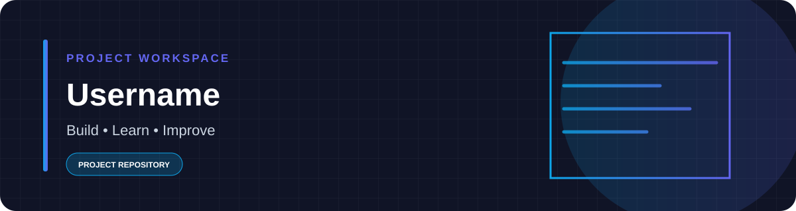

  

# Username

This repository is currently a blank scaffold. Add a short description of the project's purpose, the files needed to run it, and setup instructions before publishing it as a usable project.

## Project checklist

- [ ] Describe the goal and intended users.
- [ ] Add the source files and a minimal working example.
- [ ] Document setup and test commands.
- [ ] Keep credentials and private information out of Git.
- [ ] Add a license if you want others to reuse the project.
